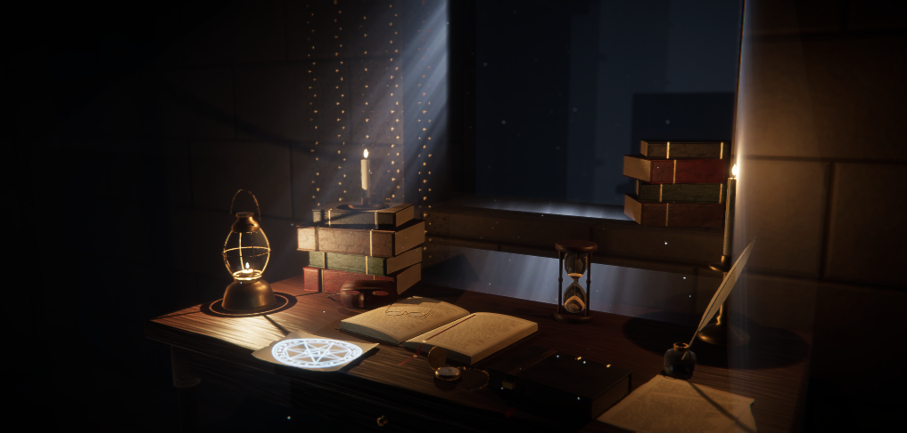

# Vanité de Franz : nature morte, version Unity

Devoir « matières, lumières, post-process », dans l'esthétique du PFE *La Bibliothèque infinie : A Matter of Time*.
Version Unreal Engine du même projet : **[lien vers le dépôt Unreal]**



## Intention

<!-- À écrire avec tes mots : inspiration, ce que raconte l'image, choix de lumière, de matières, de post-process,
     lien avec le PFE. La planche d'intention peut être ajoutée dans Docs/ et affichée ici :
      -->

## Ouvrir le projet

- **Unity 6** (6000.0 LTS ou plus récent), pipeline **HDRP**.
- Ouvrir la scène `Assets/NatureMorte/Scenes/NatureMorte.unity`.
- Vue *Game* en 1920 x 1080, puis mode **Play** : une capture est enregistrée dans `Captures/nature_morte_unity.png`.
- Pour reconstruire la scène à partir des fichiers source : menu **Nature Morte > Construire la scène**.

## Méthode

Unity et Unreal lisent les mêmes données : la géométrie `Assets/NatureMorte/Source/nature_morte.gltf` et les paramètres `Assets/NatureMorte/Source/parametres_rendu.json`, qui décrivent les matières, les lumières en unités physiques, l'exposition, la caméra et le post-process. Le script `Assets/NatureMorte/Editor/NatureMorteBuilder.cs` construit la scène à partir de ces fichiers (HDRP ou URP, détection automatique). Le script Python de la version Unreal fait de même. Les valeurs sont donc les mêmes dans les deux moteurs, et seules les conversions propres à chaque moteur diffèrent.

## Matières

| Catégorie demandée | Dans la scène | Réglage Unity (HDRP/Lit) |
|---|---|---|
| Opaque non métallique | cuirs, bois, pierre, cire, pages, sable, encre | *Opaque*, métal 0, rugosité de 0,06 (encre) à 1 (MaskMap), cartes de normales |
| Opaque métallique | laiton (lanterne, bougeoirs, montre, encrier), dorure, fer | *Opaque*, métal 1 (MaskMap R), lissé dans le canal A |
| Transparent | verre du sablier, de la lanterne, des lunettes, de l'encrier, de la montre | *Transparent*, alpha 0,14, spéculaire conservé, double face (faces arrière puis avant), sans ombre portée |
| Masqué (bonus) | dentelle du rideau, plume, feuillets, masque de cuir, parchemin énochien | *Alpha Clipping* 0,5, double face |
| Additif (en plus) | flammes, rayon de lumière, poussière | *Transparent Additive*, émission en nits |

## Lumières

Unités physiques, exposition fixe **EV100 = 1** (*Exposure > Fixed*, 0,74 avec l'atténuation de lentille par défaut de HDRP, soit exactement l'exposition d'Unreal).

| Lumière | Type | Intensité | Couleur | Ombres |
|---|---|---|---|---|
| Lumière froide de la fenêtre | directionnelle, 30° au-dessus de l'horizon | 8 lux | bleutée, environ 8 300 K | nettes (angle 1°) |
| Lanterne | ponctuelle | 3 cd | ambre, environ 3 600 K | douces (rayon 1,2 cm) |
| Bougies (2) | ponctuelles | 1,4 cd | orangée, environ 3 100 K | douces (rayon 0,8 cm) |
| Sceau énochien | ponctuelle | 0,08 cd | bleue | non |

S'y ajoutent l'éclairage indirect en espace écran (SSGI), les reflets en espace écran et une sonde de reflets en temps réel au-dessus du bureau.

## Post-process

Volume global `Volume_PostProcess` (profil `Assets/NatureMorte/Genere/NM_Volume_PostProcess.asset`) :

| Effet | Valeur | Rôle |
|---|---|---|
| Exposition fixe | EV100 = 1 | même exposition que la version Unreal |
| Tone mapping | ACES | flammes adoucies, ombres profondes |
| Bloom | 0,18, dispersion 0,65 | halo autour des flammes et du sceau |
| Profondeur de champ | caméra physique 26,38 mm, f/2, mise au point 1,66 m | le livre ouvert net, l'abîme flou |
| Vignette | 0,3, douceur 0,45 | ramener le regard vers le centre éclairé |
| Grain | *Thin1*, 0,18 | texture de pellicule ancienne |
| Aberration chromatique | 0,06 | optique imparfaite, très légère |
| Saturation et contraste | −6 et +6 | tonalité de gravure |
| Brouillard | homogène, libre parcours moyen 22 m, couleur bleutée | profondeur de l'abîme |
| Occlusion ambiante | SSAO 1,0, rayon 0,6 m | ancrer les objets sur le bureau |

## Arborescence

```
Assets/NatureMorte/
├── Editor/NatureMorteBuilder.cs      construction de la scène (menu Nature Morte)
├── Runtime/NatureMorteCapture.cs     capture en mode Play
├── Source/                           glTF, paramètres partagés avec Unreal, textures
├── Genere/                           matériaux, maillages et profil de post-process générés
└── Scenes/NatureMorte.unity
Captures/                             captures 1920 x 1080
```
